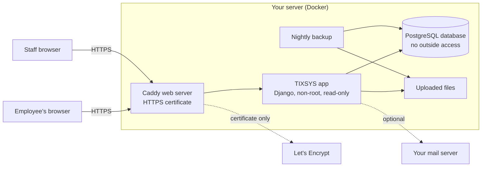

# TIXSYS security

This page is for whoever has to approve TIXSYS: what it holds, who can see what, what protects it, and how each protection is checked. Technical terms are in parentheses for an IT security reviewer.

## In one minute

- **What it holds:** help desk tickets (what's wrong, the employee's name, email, phone or extension, location, screenshots) and staff accounts. No passwords from other systems, no payment data, no Social Security numbers.
- **Who can see what:** employees see only their own tickets, through a private link with a 256-bit random code. Staff sign in with a password, plus an authenticator-app code (required for the administrator; can be required for everyone). Internal notes never reach employees.
- **Where it runs:** on a server you control. Nothing is sent to any outside service except getting the free HTTPS certificate and, if you turn it on, sending email through your own mail server. No analytics, no fonts or scripts from other sites.
- **How it's checked:** 84 automated checks run on every update; 39 of them are security checks, listed below with what each one proves. Three scanners also run: known vulnerabilities in the software it uses (pip-audit), a code security scanner (Bandit), and Django's own deployment checklist. All clean on the date in [docs/security-scan-results.md](docs/security-scan-results.md).
- **What it hasn't had:** an independent penetration test. Get one before it holds anything more sensitive than IT tickets. See [Honest limits](#honest-limits).

## What data it holds, and who can see it

| Data | Employees | Technicians and developers | Supervisor | Administrator |
|---|---|---|---|---|
| Their own tickets, replies, discussion and resolution notes | Yes, through the private link or the browser they used | Yes | Yes | Yes |
| Other employees' tickets | No | Yes | Yes | Yes |
| Internal notes and files attached to them | No | Yes | Yes | Yes |
| Reports | No | No | Yes | Yes |
| Settings, staff accounts, security log | No | No | No | Yes |

Every change to a ticket is recorded with who did it and when (ticket history). Sign-ins, failed sign-ins, lockouts, authenticator changes, private-link resets and exports are recorded in the security log, which nobody can edit or delete from the app.

## How it's put together



Only the web server (Caddy) can be reached from outside, on ports 80 and 443. Port 80 only redirects to HTTPS. The app and the database have no outside ports at all.

## Risks and what stops them

Each row names the automated check (in `helpdesk/tests/`) that proves the protection works.

| Risk | What stops it | Proved by |
|---|---|---|
| Someone guesses or edits a ticket link to read another person's ticket | Links carry a 256-bit random code (`secrets.token_urlsafe`). A wrong code is "not found", the same as a missing ticket. Staff can reset a link if it leaks; the old one stops working at once. Addresses only accept the expected characters. | `test_private_links_are_long_and_random`, `test_guessing_a_link_finds_nothing`, `test_reset_link_turns_off_the_old_one`, `test_one_ticket_link_cannot_open_another_tickets_file`, `test_wrong_token_is_404` |
| An employee sees staff-only notes or files | Internal notes and their files are filtered out of every employee page and file link. | `test_internal_notes_and_files_stay_internal`, `test_requester_never_sees_internal_notes_or_their_files` |
| Someone edits the "my tickets" cookie to list other people's tickets | The cookie is signed (tampering is detected and ignored) and hidden from scripts (HttpOnly, SameSite). | `test_my_tickets_cookie_is_signed_and_hidden_from_scripts` |
| Someone opens staff pages without signing in | Every staff page and action requires sign-in; reports need a supervisor; settings need the administrator. | `test_every_staff_page_needs_sign_in`, `test_technician_cannot_open_reports_or_settings`, `test_settings_area_only_for_administrator`, `test_only_supervisor_can_reassign_someone_elses_ticket` |
| Password guessing | Passwords must be 10+ characters and not common or all numbers. After 5 failures each try waits longer; after 10 the account locks for 30 minutes; 30 failures from one network locks that network. Error messages don't say whether a username exists. | `test_slow_down_then_lock_out`, `test_weak_passwords_are_refused`, `test_sign_ins_and_failures_are_logged` |
| A stolen or reused password | Authenticator-app codes (TOTP), required for the administrator and optionally for everyone (`REQUIRE_AUTHENTICATOR_FOR=all`). A code can't be used twice. Sign-in can't skip the code step, including for the settings area. | `test_authenticator_code_required_and_not_reusable`, `test_authenticator_codes_cannot_be_replayed`, `test_administrator_must_set_up_authenticator_first`, `test_administrator_cannot_turn_authenticator_off`, `test_authenticator_can_be_required_for_everyone`, `test_settings_sign_in_returns_to_settings` |
| A stolen database copy reveals passwords | Passwords are stored only as Argon2 hashes (the method OWASP recommends), never as text. | `test_passwords_are_stored_with_argon2` |
| Stolen sign-in cookie | HTTPS only, with HSTS so browsers refuse plain HTTP. Cookies are Secure, HttpOnly and SameSite. Sign-ins last 10 hours. | `test_production_settings_are_locked_down`, `test_django_deployment_checklist_passes` |
| Malicious text in a ticket runs in a staff member's browser (cross-site scripting) | Everything shown is escaped. A strict Content Security Policy refuses any script or style that isn't a file from this server, so injected code can't run even if something slipped through. Scripts insert text with `textContent`, never as HTML. | `test_html_in_tickets_is_shown_as_text_not_run`, `test_strict_content_security_policy`, `test_no_inline_scripts_or_styles_in_pages` |
| A link on another site makes a signed-in staff member do something (cross-site request forgery) | Every form needs a secret anti-forgery token; sign-out also needs a form. | `test_forms_need_the_anti_forgery_token`, `test_logout_needs_a_form_post` |
| TIXSYS shown inside another site to trick clicks (clickjacking) | Pages refuse to be framed (`X-Frame-Options: DENY`, `frame-ancestors 'none'`). | `test_other_protective_headers`, `test_security_headers` |
| Database tricks through the search box or addresses (SQL injection) | All database access goes through Django's query builder with parameters; no hand-written SQL. The search box only passes letters and digits to the full-text engine. Odd input of every kind is tested. | `test_strange_search_text_never_breaks_anything`, `test_strange_filter_values_never_break_anything`, `test_out_of_range_numbers_in_addresses_are_not_found` |
| A harmful file uploaded as a "screenshot" | Only PNG, JPG, GIF, WEBP and PDF are accepted, judged by the file's actual contents, not its name. Images are opened and checked; oversized "decompression bomb" images are refused. 10 MB and 5 files per upload. Files are stored under random names, outside the web folder, and served only through permission checks with `nosniff`, a sandboxed policy, and PDFs as downloads. | `test_only_real_images_and_pdfs_are_accepted`, `test_decompression_bomb_is_refused`, `test_size_limit`, `test_files_are_served_safely`, `test_fake_image_is_rejected`, `test_html_file_is_rejected_even_named_pdf` |
| Spam or a flood of fake tickets | Hidden spam-trap field, too-fast-to-be-human check, limits per network and per email address, and optionally only your organization's email domain. | `test_spam_trap_and_too_fast_are_dropped`, `test_rate_limit_per_network`, `test_email_domain_restriction` |
| Private links leaking to other sites | The browser is told not to send page addresses to other sites (`Referrer-Policy: same-origin`). The pages load nothing from other sites. | `test_portal_pages_are_never_cached`, `test_other_protective_headers` |
| Someone finds out which emails have tickets | "Email me my links" gives the same answer whether or not the address has tickets. | `test_email_links_gives_same_answer_for_unknown_address` |
| Sign-in sends people to a fake site afterwards (open redirect) | Only addresses on this site are followed after sign-in. | `test_sign_in_never_sends_people_to_another_site` |
| Requests aimed at a different site name (host header attacks) | Only the configured address is accepted. | `test_unknown_host_names_are_refused` |
| An unnoticed account takeover or data grab | Security log: sign-ins with address and browser, failures, lockouts, authenticator changes, link resets and every export. Read-only, even for the administrator. | `test_sign_ins_and_failures_are_logged`, `test_exports_are_logged`, `test_security_log_is_read_only`, `test_settings_changes_are_recorded` |
| Deployed with test settings by mistake | The app refuses to start without a secret key. Django's deployment checklist passes with the production settings. | `test_app_refuses_to_start_without_a_secret_key`, `test_django_deployment_checklist_passes` |
| Lost phone locks out the only administrator | Server-only command `./tixsys reset-authenticator <user>`, which is logged. | `test_lost_phone_reset_from_the_server` |

## The server setup

- Runs in Docker containers. If one part were broken into, the damage is boxed in:
  - The app runs as a normal user (not root), with a read-only file system (it can write only uploads and temporary files), with every Linux capability removed, and can't gain new privileges.
  - The web server keeps only the one capability it needs (opening ports 80 and 443).
  - The database isn't reachable from outside the server.
- Secrets (the app's secret key and the database password) are generated randomly by `./tixsys setup` and kept in the `.env` file, readable only by its owner. They're never in the code.
- The app's Python packages are pinned to exact versions in `requirements.txt` and checked for known vulnerabilities. The Docker images stay on fixed major versions (Python 3.13, PostgreSQL 16, Caddy 2), and `./tixsys update` takes a backup, then pulls their latest security patches.
- Backups run every night and keep the newest 14. Backup files are readable only by their owner.

## Checks and scans

Run every check yourself:

```
./tixsys test
```

Scanner commands and the latest results: [docs/security-scan-results.md](docs/security-scan-results.md).

## Running it safely

For whoever looks after the server:

1. Use a domain name so HTTPS is on. (The `http://` IP-address mode is for testing with fake data only.)
2. Turn on authenticator apps for everyone: add `REQUIRE_AUTHENTICATOR_FOR=all` to `.env`, then `./tixsys restart`.
3. Let only ports 80 and 443 in from the internet, plus SSH (port 22) for the administrator, ideally only from your network. Sign in to the server with SSH keys, not passwords.
4. Keep the server patched (Ubuntu: turn on unattended upgrades) and run `./tixsys update` monthly.
5. Copy the `backups/` folder off the server regularly. Backups contain tickets and the server's secrets, so store them like any other confidential file.
6. When someone leaves, turn their account off in Settings (Staff accounts, untick Active) the same day.
7. Look over the security log in Settings now and then for repeated failed sign-ins or exports you don't expect.
8. Before going live, run `./tixsys clear-demo` to remove the demo accounts and tickets.
9. If you turn on email, use your mail server's TLS port (587) with a dedicated account.

## If something goes wrong

- **A staff account may be compromised:** turn the account off in Settings, reset its password (`./tixsys password <user>`) and authenticator (`./tixsys reset-authenticator <user>`), then check the security log and the ticket history for what it did.
- **A private ticket link was shared by mistake:** open the ticket and use "Reset link". The old link stops working at once.
- **The server may be compromised:** take it offline (`./tixsys stop`), set up a fresh server, restore the most recent good backup there (`./tixsys restore <file>`), then change the secrets: delete the old `.env` values for `SECRET_KEY` and `POSTGRES_PASSWORD`, set new random ones, and reset all staff passwords.

## Honest limits

What v1 does not do, so nobody assumes it does:

- **No independent penetration test yet.** The checks above are thorough but were written by the same team that built it. Have an outside tester review it before it holds more sensitive data.
- **Employees aren't verified.** Anyone who can reach the portal can submit a ticket under any name. The email-domain restriction, rate limits and spam checks reduce abuse; Microsoft (Azure) sign-in for employees would remove it, and isn't in v1.
- **Staff sign-in isn't connected to Microsoft accounts.** Turning off a departed employee's account is a separate step in Settings.
- **Inside the server, the app connects to the database as its owner account.** The database can't be reached from outside, and the app never builds SQL by hand, but a separate least-privilege database account would add one more layer.
- **Uploaded files aren't virus-scanned.** Only images and PDFs are accepted and none are ever run on the server; staff computers should still have normal antivirus.
- **Email isn't encrypted end to end.** With email on, ticket links and updates travel like any other email.
- **Tickets are kept until deleted.** There's no automatic deletion after a set time.
- **A lockout can be triggered on purpose.** Someone who knows a staff username can lock that account for 30 minutes by failing sign-ins; `./tixsys unlock <user>` ends it early.

## Reporting a security problem

Tell the TIXSYS administrator directly. Don't post details anywhere public.
