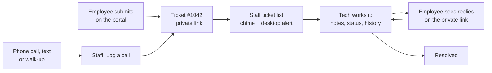
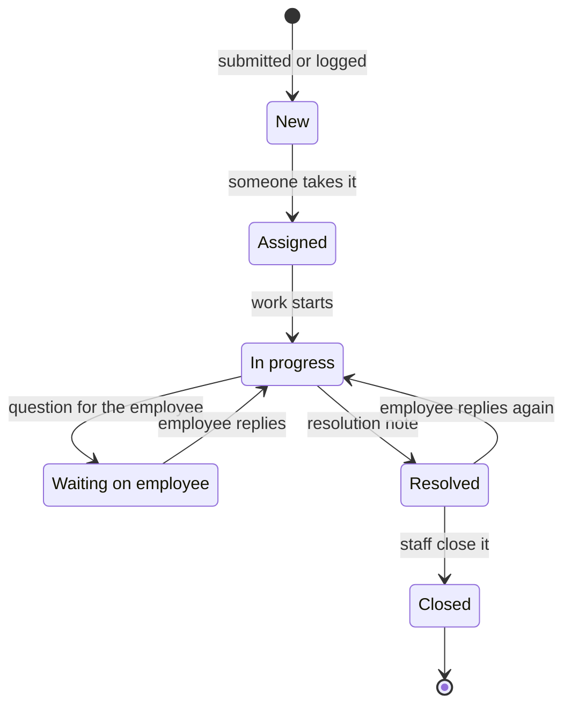

# How TIXSYS works

## The short version

Employees go to one web address, say what's wrong, and get a ticket number and a private link. The help desk hears a chime and sees the ticket right away, works it from one shared list, and the employee sees every reply on their private link (and by email, if email is turned on). Supervisors get reports. All of it runs on one server you control.

## What an employee does

1. Opens the help desk address, for example `help.yourorg.org`. No account, no password.
2. Types what's wrong. The first line becomes the ticket's summary. Picks a category, fills in name, email, phone or extension and location (the browser remembers these next time), and attaches screenshots if they have them.
3. Gets a ticket number and a private link to bookmark.
4. Opens that link any time to see the status, read replies, and answer. "My tickets" lists every ticket sent from that browser.
5. Needs hands-on help? "Remote help" has an "Open Quick Assist" button, a picture guide to Quick Assist, and each tech's Zoom link.
6. "How-to articles" has short guides the administrator writes, like resetting a password.

## What the help desk does

1. Signs in at `/staff/` with a password and, if required, a code from an authenticator app.
2. Works from the ticket list: quick views (All open, Mine, Unassigned, My board, Resolved and closed, Everything), filters, and a search box (see Searching below).
3. Opens a ticket to assign it, change status, priority or board, and add notes:
   - **Discussion**: the employee sees it. Tick "Waiting on employee" when you need an answer.
   - **Internal**: staff only.
   - **Resolution**: the employee sees it, and the ticket is marked Resolved.
4. Every change is recorded in the ticket's history: who, what, when.
5. **Log a call** turns a phone call, text or walk-up into a ticket, marked with how it came in.
6. **New-ticket alerts**: a chime and a desktop notice while the workspace is open in a browser tab.
7. **Export as text**: copy one ticket, or download the whole list as a text file, to paste into another system.
8. **Reports** (supervisors and the administrator): tickets per day in 3D, portal versus phone, opened versus resolved, when people ask for help, time to fix, where tickets go, open work by board, status and person, and the oldest open tickets.

## How a ticket moves

A closed ticket can't get new replies; the employee is told to submit a new one.

## Searching

The search box looks through every ticket, its notes, and the requester's details. Words match their other forms ("print" finds "printing"), and "wifi" also finds "Wi-Fi".

| Type | Finds |
|---|---|
| `printer jam` | tickets with both words |
| `"blue screen"` | that exact phrase |
| `vpn OR wifi` | either word |
| `outlook -calendar` | leaves out tickets with a word |
| `#1042` | ticket 1042 |
| `status:resolved`, `-status:closed` | by status (or not) |
| `assignee:me`, `assignee:none`, `assignee:marcus` | by who has it |
| `board:database`, `category:printer`, `priority:high` | by board, category, priority |
| `requester:grace`, `location:"room 210"` | by who asked, or where |
| `opened:<7d`, `resolved:>30d`, `opened:2026-09`, `opened:2026-09-01..2026-09-15` | by date |
| `has:attachment`, `has:internal`, `is:open`, `is:unassigned` | other handy filters |

Mix them: `printer status:resolved opened:<30d`. Save any search to the sidebar with "Save search".

## Where the data lives

Everything is on your server: one PostgreSQL database and one folder of uploaded files. A backup of both runs every night (3 AM Pacific by default) and the newest 14 are kept in the `backups/` folder. One command makes a backup file (`./tixsys backup`) and one command loads it, on the same server or a new one (`./tixsys restore <file>`). That's also how you move TIXSYS to a different server.

Nothing goes to outside services. The only outside connections are getting the free HTTPS certificate and, if you turn it on, sending email through your own mail server.

## A 5-minute demo for a director

Before: run `./tixsys demo` (it prints a password for the demo accounts) and open two browser windows.

1. **Employee window**, the portal: submit "My second monitor is black", attach a screenshot. Point out: no sign-in, a ticket number, a private link.
2. **Staff window**, signed in as `demo.marcus`: the chime and the desktop notice. Open the ticket, click "Assign to me", add a Discussion note "Is the cable plugged in at both ends?" and tick "Waiting on employee".
3. **Employee window**: refresh the private link. The question is there. Reply "Yes, still black". The ticket goes back to In progress on its own.
4. **Staff window**: add a Resolution note "Replaced the cable." The employee's page now shows it resolved.
5. Search: `monitor status:resolved opened:<7d`. Then "Export as text" to show the copy-and-paste path into the old system.
6. Sign out and sign in as `demo.director`. Open Reports:
   - Drag the 3D chart around. The tall tower is the day email went down: a dozen tickets in one morning.
   - "Portal vs. phone": the share of tickets coming through the portal instead of calls, week by week.
   - "Time to fix" and "Opened vs. resolved": are we keeping up?
7. Close with [SECURITY.md](../SECURITY.md): 47 security tests, clean scans, an internal review whose four findings are fixed, runs on our own server, no outside services.

Afterwards, `./tixsys clear-demo` removes the demo tickets and accounts and keeps anything real.
